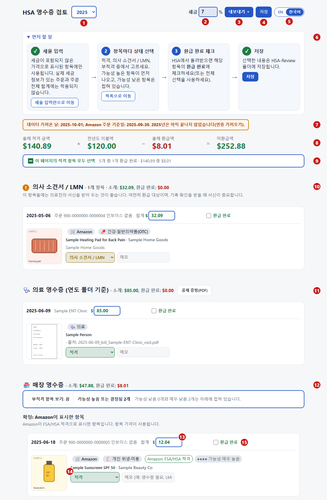

# HSA 영수증 검토 (HSA Receipt Review)

[English](README.md) | **한국어**

> 영어 원문([README.md](README.md))이 기준 문서입니다.

세금 신고를 위해 HSA 적격 구매 내역과 의료 영수증을 검토하고 정리하는, 개인용 로컬 대시보드입니다.

건강저축계좌(HSA)는 적격 의료비를 비과세로 지출할 수 있는 계좌이지만, 실제로 적격인 항목이고 영수증이 있을 때만 해당됩니다. 이 도구는 1년치 구매 내역을 적격, 의사 소견서 필요, 부적격으로 분류하고 환급받은 금액을 기록합니다. [HSA에 대해 더 알아보기](#hsa-소개와-이-도구를-만든-이유).

이 프로젝트는 **LLM 사용자**(Claude Code, Cursor, Gemini CLI 등)를 위해 만들었습니다. Python 스크립트를 직접 작성하거나 실행할 필요가 없습니다. AI 어시스턴트가 파일을 관리하고, 상태를 확인하고, 주문을 백그라운드에서 가져오며, 사용자는 브라우저 대시보드에서 모든 내용을 확인하고 승인합니다. 기술 구조와 데이터 흐름은 [HOW_IT_WORKS.ko.md](HOW_IT_WORKS.ko.md)를 참고하세요.

> **지원 범위:** Amazon 주문(Amazon MCP 서버가 대신 읽습니다)과 직접 스캔하거나 저장한 영수증(병원 청구서, 약국·매장 영수증)입니다. 다른 온라인 매장의 계정은 자동으로 읽지 않습니다.

---

## 빠른 체험 (설정 불필요)

설정하기 전에 대시보드가 어떻게 동작하는지 보고 싶으신가요?

1. **Chrome** 또는 **Edge**에서 `review.html`을 엽니다.
2. 폴더를 선택하라는 안내가 나오면 이 저장소의 `samples` 폴더를 선택합니다.
3. 가상의 영수증, 적격 여부 필터, 청구 보고서를 둘러봅니다. 브라우저가 파일을 직접 읽으므로 서버나 Python이 필요하지 않습니다.



| # | 설명 |
|---|---|
| 1 | **연도:** 데이터 폴더에 있는 과세 연도를 바꿉니다. |
| 2 | **세율 %:** 세금이 표시되지 않은 항목 가격에 더할 판매세입니다. |
| 3 | **내보내기:** HSA 관리 기관에 제출할 청구 보고서와 CSV입니다. |
| 4 | **저장:** 결정 내용을 `decisions.json`에 기록합니다(저장하지 않은 내용이 있으면 색이 바뀝니다). |
| 5 | **EN \| 한국어:** 페이지를 한국어로 바꾸거나 되돌립니다. 선택은 기억됩니다. 상품명, 메모, 내보낸 보고서는 그대로 유지됩니다. |
| 6 | **먼저 할 일:** 네 단계입니다. 세율 입력, 항목마다 상태 선택, 환급 완료 체크, 저장. |
| 7 | **데이터 가져온 날 / 주문 기준일:** 데이터가 얼마나 최신인지 보여 주며, 해당 연도가 끝나지 않았으면 경고합니다. |
| 8 | **합계:** 올해 적격 금액 + 전년도 이월액 - 환급액 = 앞으로 청구할 금액입니다. |
| 9 | **이 페이지의 적격 항목 모두 선택:** 적격 항목 전체를 한 번에 환급 완료로 표시합니다. |
| 10 | **의사 소견서 / LMN:** 의료진의 서신이 필요한 항목입니다. 환급은 여전히 가능합니다. |
| 11 | **의료 영수증:** 연도 폴더에 있는 청구서이며, **공제 증빙(PDF)** 버튼이 있습니다. |
| 12 | **매장 영수증:** Amazon 주문이며, 부적격 항목을 보이거나 숨기는 스위치가 있습니다. |
| 13 | **금액:** 계산에 넣을 금액입니다. 가격의 일부만 적격이면 수정하세요(↺를 누르면 원래대로 돌아갑니다). |
| 14 | **상태:** 적격, 의사 소견서 / LMN, 부적격, 미결정 중 하나입니다. Amazon의 "FSA/HSA 적격" 표시는 참고용일 뿐입니다. |
| 15 | **환급 완료:** HSA에서 돌려받았을 때 체크하면 날짜가 자동으로 채워집니다. |

`samples` 폴더에는 가상의 2025년 데이터가 들어 있습니다(주문 번호가 `900-`으로 시작합니다). 따라서 여기 있는 내용은 실제 기록이 아닙니다. 스크린샷에는 폴더 버튼이 빠져 있습니다. `review.html`을 직접 열면 이 버튼이 오른쪽 위에 있으며, 폴더를 열기 전에는 **영수증 폴더 선택**이라고 표시되고 폴더를 연 뒤에는 폴더 이름이 표시됩니다.

---

## HSA 소개와 이 도구를 만든 이유

**HSA**는 적격 의료비를 위한 세전 저축 계좌입니다. 납입하려면 **고공제 건강보험(HDHP)** 에 가입되어 있어야 하며, 쓰지 않은 금액은 다음 해로 이월됩니다([Healthcare.gov](https://www.healthcare.gov/high-deductible-health-plan/), [HSA 개설하기](https://www.healthcare.gov/high-deductible-health-plan/setting-up-hsa/)). 적격 의료비로 인출하면 비과세입니다. 그 밖의 인출은 대체로 과세 대상이며 20% 세금이 추가될 수 있습니다([IRS Pub. 969](https://www.irs.gov/publications/p969)).

**검토 도구가 필요한 이유.** 한 가구가 1년에 Amazon에서 수백 건을 주문할 수 있는데, 그중 일부 항목만 적격입니다.
- **항목별 판단:** 일반적으로 건강 전반이 아니라 질환을 진단, 치료, 완화, 예방하는 것이 주된 목적일 때 적격 의료비가 됩니다([IRS Pub. 502](https://www.irs.gov/publications/p502)).
- **일반의약품(OTC)** 은 2020년부터 처방전 없이도 적격입니다([IRS 요약](https://www.irs.gov/newsroom/irs-outlines-changes-to-health-care-spending-available-under-cares-act)). Pub. 502만 보면 아직 이전 규정이 나와 있습니다.
- **겸용 물품**(마사지 기구, 공기청정기 등)은 의료진이 작성한 의료 필요성 증명서(LMN)가 필요할 수 있습니다.
- **기록:** 항목별로 적힌 영수증을 보관하세요. 같은 비용을 두 번 환급받을 수 없고, HSA를 개설한 이후에 발생한 비용이어야 합니다(Pub. 969).

도구는 제안만 하고 결정은 사용자가 하며, 어떤 데이터도 컴퓨터 밖으로 나가지 않습니다. 이 도구는 분류를 돕는 용도이며 세무 자문이 아닙니다. 도구가 참고하는 요약은 출처와 검토 날짜와 함께 [`eligibility_reference.md`](skills/hsa-categorize/eligibility_reference.md)(영어)에 있습니다.

---

## 시작하기: AI 어시스턴트에게 맡기세요

터미널 명령을 실행할 필요가 없습니다. 이 프로젝트 폴더에서 LLM 에이전트를 시작하고 다음과 같이 요청하세요.

> *"Open my HSA review"*  
> *(또는: "Read [AGENTS.md](AGENTS.md) and set up my HSA review")*

### 어시스턴트가 대신 해 주는 일
1. **데이터 폴더 준비:** 환경을 확인하고 이 저장소 밖에 본인의 비공개 데이터 폴더(예: `Documents/HSA-Review`)를 만듭니다.
2. **Amazon 도구 연결:** 읽기 전용 Amazon MCP 서버를 설정해, 요청이 있을 때 주문 내역과 인보이스 PDF를 가져올 수 있게 합니다.
3. **체크리스트 관리:** 현재 진행 상황을 확인하고 바로 다음에 할 일을 정확히 알려 줍니다.
4. **적격 여부 초안 작성:** 항목을 IRS Publication 502 기준과 대조하고, 사용자가 검토할 후보 메모를 추가합니다.

영수증, 금융 관련 결정, 개인 기록은 모두 본인 컴퓨터의 비공개 데이터 폴더에만 보관됩니다.

---

## 검토하는 방법 (Python 불필요)

어시스턴트가 주문과 영수증을 모아 두면, 사용자는 화면에서 검토합니다.

1. **Chrome** 또는 **Edge**에서 `review.html`을 더블클릭합니다(설정 중에 만든 바탕화면 바로 가기를 써도 됩니다).
2. 안내가 나오면 비공개 데이터 폴더를 선택합니다(브라우저가 다음을 위해 기억합니다).
3. 항목을 검토합니다. **적격**, **부적격**, **LMN**(의료 필요성 증명서) 필요 중에서 표시하고, 환급받은 금액을 기록합니다.
4. 내보내기: **청구 보고서(PDF)** 또는 **항목(CSV)** 을 눌러 HSA 관리 기관이나 세무 기록에 쓸 문서를 만듭니다.

Chrome과 Edge에서는 검토 페이지가 브라우저의 기본 파일 접근 기능으로 로컬 데이터 폴더에 직접 연결됩니다. 검토하고 저장하는 데 로컬 서버, 명령줄, Python이 필요하지 않습니다.

---

## 동작 방식

전체 구조, 구성 요소별 역할("누가 무엇을 하나"), MCP 동작 방식은 **[HOW_IT_WORKS.ko.md](HOW_IT_WORKS.ko.md)** 를 참고하세요.

전체 흐름은 AI 어시스턴트의 파일 처리 능력과 사용자의 화면 검토를 결합한 것입니다.

```text
 1. 로그인 (최초 1회)
    └── 브라우저 창에서 직접 로그인합니다. 세션 쿠키는 ~/.amazon-orders-mcp/ 에 로컬로만 보관됩니다

 2. 데이터 수집 (LLM + MCP)
    ├── Amazon에 실제로 접속하는 요청마다 사용자가 승인합니다
    ├── MCP 서버가 주문 페이지를 읽고 인보이스 PDF를 receipts/ 에 내려받습니다
    └── 병원 청구서나 약국 영수증은 사용자가 receipts/ 에 넣습니다 (어시스턴트가 파일 이름을 자동으로 붙입니다)

 3. 분류 (LLM)
    └── 어시스턴트가 항목을 살펴보고 IRS Pub. 502 기준의 적격 여부 메모 초안을 작성합니다

 4. 검토와 결정 (브라우저 - Python 불필요)
    ├── 어시스턴트가 처리한 항목을 <data folder>/<year>/_app/data.json 에 기록합니다
    └── 사용자가 review.html을 열어 적격 여부를 확정하고, 메모를 고치고, 환급 내역을 기록합니다

 5. 내보내기 (브라우저)
    └── 청구 보고서 PDF, 의료 증빙 PDF, CSV를 만듭니다
```

---

## Model Context Protocol (MCP) 사용

이 프로젝트에는 [`mcp/amazon-orders/`](mcp/amazon-orders/README.md)(영어)에 Amazon MCP 서버가 들어 있습니다(`seanoliver/amazon-orders-mcp` 기반). 이 서버 덕분에 AI 어시스턴트가 직접 입력하지 않아도 주문 내역을 읽고 상품의 적격 여부를 확인할 수 있습니다.

### 사용할 수 있는 도구

| 도구 | 로그인 필요 | 용도 |
|---|---|---|
| `refresh_session` | 예 (창이 보임) | Amazon 로그인과 2단계 인증을 위해 대화형 Chromium 브라우저를 엽니다. 세션은 `~/.amazon-orders-mcp/cookies.json`에 로컬로 저장합니다. |
| `get_order_history(year)` | 예 (headless) | 특정 과세 연도의 주문 번호와 날짜를 가져옵니다. |
| `get_order(order_id)` | 예 (headless) | 주문의 항목, 가격, 판매자 정보, 인보이스 PDF를 가져옵니다. |
| `check_asin_eligibility(asin)` | 아니요 (headless) | 공개된 Amazon 상품 페이지에 "FSA or HSA eligible" 배지가 있는지 확인합니다. |

### 안전 장치
- **읽기 전용:** 도구는 주문 내역과 공개 상품 페이지만 살펴봅니다. 구매, 장바구니 담기, 계정 설정 변경은 절대 하지 않습니다.
- **명시적 승인:** 어시스턴트는 Amazon에 실제로 접속하는 요청을 보내기 전에 반드시 사용자의 확인을 받아야 합니다.
- **비공식, 본인 계정 전용:** Amazon과 제휴하거나 Amazon의 보증을 받은 도구가 아닙니다. 본인의 계정을, 본인의 로그인으로, 본인의 기록을 위해서만 읽습니다. Amazon 이용약관이 자동화된 접속을 제한할 수 있으므로 약관을 확인하고, 사용에 따른 책임은 본인에게 있습니다.
- **세션 만료:** 주문 페이지는 최근 1시간 안에 활성화된 Amazon 세션이 필요합니다.
- **설정과 동작 방식:** [`.mcp.json.example`](.mcp.json.example)을 `.mcp.json`으로 복사하거나 사용하는 클라이언트에서 설정하세요. 설정은 [`mcp/amazon-orders/README.md`](mcp/amazon-orders/README.md)(영어), 내부 데이터 흐름은 [`HOW_IT_WORKS.ko.md`](HOW_IT_WORKS.ko.md)를 참고하세요.

---

## 문서와 파일의 역할

| 문서 / 폴더 | 역할 |
|---|---|
| [`review.html`](review.html) | 항목 검토, 메모 편집, 청구 내보내기를 위한 웹 대시보드입니다. Python 없이 Chrome/Edge에서 바로 실행됩니다. |
| [`HOW_IT_WORKS.ko.md`](HOW_IT_WORKS.ko.md) | 기술 구조, 구성 요소별 역할("누가 무엇을 하나"), 데이터 흐름도, MCP 동작 방식, 데이터 폴더 구성, 이월 규칙, 로그 한도를 설명합니다. |
| [`AGENTS.md`](AGENTS.md) (영어) | AI 어시스턴트를 위한 기본 규칙서입니다. 설정 단계, 도구 호출, 안전 한계를 다룹니다. |
| [`mcp/amazon-orders/`](mcp/amazon-orders/README.md) (영어) | Amazon Orders MCP 서버 코드, 도구 정의, 등록 안내입니다. |
| [`skills/`](skills/) | AI 어시스턴트를 위한 작업별 안내서입니다(`hsa-review`, `hsa-setup`, `amazon-live-batch`, `hsa-categorize`, `hsa-reports`, `hsa-organize-files`). |
| [`skills/hsa-categorize/eligibility_reference.md`](skills/hsa-categorize/eligibility_reference.md) (영어) | IRS Publication 502의 적격 기준과 적격 의료비 항목을 정리한 자료입니다. |
| [`templates/`](templates/) | 새 과세 연도를 시작할 때 쓰는 JSON 구조 예시 파일입니다. |
| [`samples/`](samples/) | 테스트와 30초 체험에 쓰는 공개 가상 데이터입니다. |

---

## 개인정보와 저장 위치

- **코드 폴더(이 저장소):** 소프트웨어와 샘플만 들어 있습니다. 업데이트하거나 git에 커밋해도 안전하며, 개인 데이터는 전혀 없습니다.
- **데이터 폴더(`Documents/HSA-Review`):** 개인 영수증, 결정 내용, 세무 기록이 들어 있습니다. 로컬에만 보관되며 Git 밖에 있습니다.
- 개인정보 점검: 언제든 `python tools/check_personal_data.py`를 실행하거나 어시스턴트에게 실행을 요청하면, 코드 폴더에 개인 파일이 들어가 있지 않은지 확인할 수 있습니다.

---

## 내부 동작 (선택: CLI 명령)

이 명령들은 AI 어시스턴트가 대신 실행하지만, 터미널을 선호하면 직접 실행해도 됩니다.

| 명령 | 하는 일 |
|---|---|
| `python tools/hsa.py status` | 현재 상태 체크리스트와 바로 다음에 할 일 하나를 보여 줍니다 |
| `python tools/hsa.py setup` | 단계별로 안내하는 설정 스크립트입니다 |
| `python tools/hsa.py open` | 검토 대시보드를 브라우저에서 엽니다 (Firefox/Safari에서 필요) |
| `python tools/hsa.py shortcut` | 더블클릭용 바탕화면 바로 가기를 만듭니다 |
| `python tools/organize_files.py <folder>` | 영수증 파일의 이름을 자동으로 붙이고 데이터 폴더로 정리합니다 |
| `python tools/hsa.py invoices` | 인보이스 영수증이 없는 적격 주문을 나열합니다 |
| `python tools/check_personal_data.py` | 코드 폴더에 개인 데이터가 없는지 확인합니다 |

---

*면책: 세무 또는 법률 자문이 아닙니다. 청구하기 전에 HSA 관리 기관의 규정과 IRS Publication 502를 확인하세요. Amazon과 제휴 관계가 없으며, Amazon 리더를 사용하기 전에 Amazon 이용약관을 확인하세요.*
