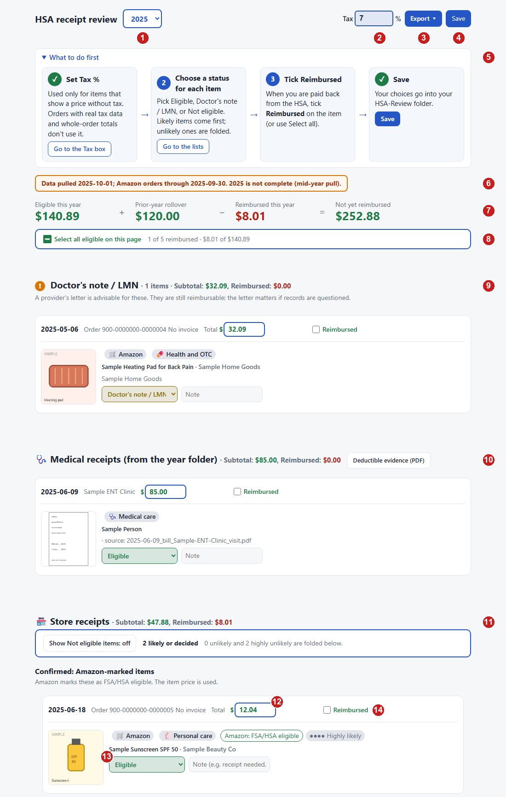

# HSA Receipt Review

**English** | [한국어](README.ko.md)

A private, local dashboard to review and organize your HSA-eligible purchases and medical receipts for taxes.

A Health Savings Account (HSA) pays qualified medical expenses tax-free, but only for items that truly qualify, backed by a receipt. This tool sorts a year of purchases into eligible, doctor's note needed, and not eligible, and tracks what you have been reimbursed. [More about HSAs](#about-hsas-and-why-this-tool-exists).

This project is built for **LLM users** (Claude Code, Cursor, Gemini CLI, etc.). You do not need to write or run Python scripts yourself: your AI assistant manages the files, checks status, and pulls orders in the background, while you review and approve everything in a visual browser dashboard. For technical architecture and data flow, see [HOW_IT_WORKS.md](HOW_IT_WORKS.md).

> **What it covers:** Amazon orders (read for you by the Amazon MCP server) and receipts you scan or save yourself (clinic bills, pharmacy and store receipts). Other online stores' accounts are not read automatically.

---

## Quick Demo (No Setup)

Want to see how the dashboard works before setting anything up?

1. Open `review.html` in **Chrome** or **Edge**.
2. Select the `samples` folder in this repository when prompted.
3. Explore the dashboard with simulated receipts, eligibility filters, and claim reports. The browser reads files directly—no server or Python needed.



| # | What it is |
|---|---|
| 1 | **Year:** switch between tax years in your data folder. |
| 2 | **Tax %:** sales tax added to item prices that show no tax. |
| 3 | **Export:** claim report and CSV for your HSA administrator. |
| 4 | **Save:** writes your decisions to `decisions.json` (turns a different color when something is unsaved). |
| 5 | **EN \| 한국어:** shows the page in Korean and back; your choice is remembered. Product titles, notes, and exported reports stay as they are. |
| 6 | **What to do first:** the four steps: set Tax %, choose a status per item, tick Reimbursed, Save. |
| 7 | **Data pulled / orders through:** how current the data is; warns if the year is incomplete. |
| 8 | **Totals:** eligible this year + prior-year rollover − reimbursed = still to claim. |
| 9 | **Select all eligible:** mark every eligible item reimbursed at once. |
| 10 | **Doctor's note / LMN:** items that need a provider's letter. Still reimbursable. |
| 11 | **Medical receipts:** bills from the year folder, with a **Deductible evidence (PDF)** button. |
| 12 | **Store receipts:** Amazon orders, with a switch to show or hide Not eligible items. |
| 13 | **Amount:** the amount to count; edit it if only part of the price qualifies (↺ resets it). |
| 14 | **Status:** Eligible, Doctor's note / LMN, Not eligible, or Undecided. Amazon's "FSA/HSA eligible" label is only a hint. |
| 15 | **Reimbursed:** tick when your HSA has paid you back; a date is filled in. |

The `samples` folder holds fake 2025 data (order numbers start with `900-`), so nothing here is a real record. The screenshot omits the folder button, which sits at the top right when you open `review.html` directly: it shows **Choose receipts folder** until a folder is open, then the folder's name.

---

## About HSAs, and Why This Tool Exists

An **HSA** is a pre-tax savings account for qualified medical expenses. You need a **high-deductible health plan (HDHP)** to contribute, and unused money rolls over ([Healthcare.gov](https://www.healthcare.gov/high-deductible-health-plan/), [setting up an HSA](https://www.healthcare.gov/high-deductible-health-plan/setting-up-hsa/)). Withdrawals for qualified expenses are tax-free; other withdrawals are generally taxable and may add a 20% tax ([IRS Pub. 969](https://www.irs.gov/publications/p969)).

**Why a review tool.** A household can place hundreds of Amazon orders a year, and only some items qualify:
- **Item by item:** an expense generally qualifies when its main purpose is to diagnose, treat, ease, or prevent a medical condition, not just general health ([IRS Pub. 502](https://www.irs.gov/publications/p502)).
- **Over-the-counter medicine** counts without a prescription since 2020 ([IRS summary](https://www.irs.gov/newsroom/irs-outlines-changes-to-health-care-spending-available-under-cares-act)); Pub. 502 alone still shows the older rule.
- **Dual-use items** (a massage tool, an air purifier) may need a provider's letter of medical necessity (LMN).
- **Records:** keep itemized receipts; no expense can be reimbursed twice, and it must come after the HSA was set up (Pub. 969).

The tool suggests, you decide, and nothing leaves your computer. This is a sorting aid, not tax advice; the summary it uses, with sources and review date, is in [`eligibility_reference.md`](skills/hsa-categorize/eligibility_reference.md).

---

## Getting Started: Let Your AI Assistant Do the Work

You do not need to run terminal commands. Start your LLM agent in this project folder and prompt:

> *"Open my HSA review"*  
> *(or: "Read [AGENTS.md](AGENTS.md) and set up my HSA review")*

### What your assistant does for you:
1. **Initializes your data folder:** Verifies your environment and creates your private data folder (outside this repository, e.g. `Documents/HSA-Review`).
2. **Connects Amazon tools:** Configures the read-only Amazon MCP server so it can fetch order history and invoice PDFs on request.
3. **Tracks your checklist:** Inspects where you are and tells you the exact next step.
4. **Drafts eligibility:** Matches items against IRS Publication 502 guidelines and adds candidate notes for your review.

All your receipts, financial decisions, and personal records remain strictly on your local machine in your private data folder.

---

## How to Review (No Python Required)

Once your assistant has gathered your orders or receipts, you review them visually:

1. Double-click `review.html` in **Chrome** or **Edge** (or use the Desktop shortcut created during setup).
2. Choose your private data folder when prompted (the browser remembers it for next time).
3. Review items: mark them as **Eligible**, **Not eligible**, or **Need LMN** (Letter of Medical Necessity), and track reimbursed amounts.
4. Export: Click **Claim report** or **Export CSV** to generate documentation for your HSA administrator or tax records.

In Chrome and Edge, the review page connects directly to your local data folder using native browser file access. No local server, command line, or Python runtime is required to review or save.

---

## How It Works

For complete architecture details, component roles ("Who does what"), and MCP mechanics, see **[HOW_IT_WORKS.md](HOW_IT_WORKS.md)**.

The overall workflow combines your AI assistant's file-handling capabilities with your visual review:

```text
 1. Sign In (One-time)
    └── You sign in via a browser window; session cookies stay local in ~/.amazon-orders-mcp/

 2. Gather Data (LLM + MCP)
    ├── You approve each live Amazon request
    ├── MCP server reads order pages and downloads invoice PDFs into receipts/
    └── You drop clinic bills or pharmacy receipts into receipts/ (assistant auto-names them)

 3. Categorize (LLM)
    └── Assistant inspects items and drafts IRS Pub. 502 eligibility notes

 4. Review & Decide (Browser - No Python)
    ├── Assistant writes processed items to <data folder>/<year>/_app/data.json
    └── You open review.html: confirm eligibility, edit notes, and track reimbursements

 5. Export (Browser)
    └── Generate Claim Report PDF, Medical Evidence PDF, or CSV export
```

---

## Model Context Protocol (MCP) Usage

The project includes an Amazon MCP server in [`mcp/amazon-orders/`](mcp/amazon-orders/README.md) (based on `seanoliver/amazon-orders-mcp`). It allows your AI assistant to read order history and check product eligibility without manual data entry.

### Available Tools

| Tool | Login Required | Purpose |
|---|---|---|
| `refresh_session` | Yes (visible window) | Opens an interactive Chromium browser for Amazon sign-in and 2FA. Saves session locally to `~/.amazon-orders-mcp/cookies.json`. |
| `get_order_history(year)` | Yes (headless) | Scrapes order IDs and dates for a specific tax year. |
| `get_order(order_id)` | Yes (headless) | Retrieves items, prices, seller info, and invoice PDFs for an order. |
| `check_asin_eligibility(asin)` | No (headless) | Checks public Amazon product pages for the "FSA or HSA eligible" badge. |

### Safety Constraints
- **Read-only:** Tools only inspect order history and public product pages. They never buy, add to cart, or modify account settings.
- **Explicit approval:** The assistant must ask for your confirmation before making any live Amazon requests.
- **Unofficial, for your own account:** Not affiliated with or endorsed by Amazon. It reads only your own account, with your own sign-in, for your own records. Amazon's terms of use may restrict automated access, so check them and use it at your own risk.
- **Session expiry:** Order pages require an Amazon session active within the last hour.
- **Setup & Mechanics:** Copy [`.mcp.json.example`](.mcp.json.example) to `.mcp.json` or configure in your client. See [`mcp/amazon-orders/README.md`](mcp/amazon-orders/README.md) for setup and [`HOW_IT_WORKS.md`](HOW_IT_WORKS.md) for internal data flow.

---

## Documentation and File Roles

| Document / Folder | Role |
|---|---|
| [`review.html`](review.html) | The web dashboard for reviewing items, editing notes, and exporting claims. Runs directly in Chrome/Edge without Python. |
| [`HOW_IT_WORKS.md`](HOW_IT_WORKS.md) | Technical architecture, component roles ("Who does what"), data flowchart, MCP mechanics, data folder layout, rollover rules, and log limits. |
| [`AGENTS.md`](AGENTS.md) | The primary rulebook and instructions for your AI assistant. Covers setup steps, tool calls, and safety bounds. |
| [`mcp/amazon-orders/`](mcp/amazon-orders/README.md) | Amazon Orders MCP server code, tool definitions, and registration guides. |
| [`skills/`](skills/) | Specialized task guides for AI assistants (`hsa-review`, `hsa-setup`, `amazon-live-batch`, `hsa-categorize`, `hsa-reports`, `hsa-organize-files`). |
| [`skills/hsa-categorize/eligibility_reference.md`](skills/hsa-categorize/eligibility_reference.md) | Reference of IRS Publication 502 eligibility criteria and qualifying health care expense categories. |
| [`templates/`](templates/) | Example JSON structure files used when initializing a new tax year. |
| [`samples/`](samples/) | Public synthetic test data used for testing and the 30-second demo. |

---

## Privacy and Storage

- **Code folder (this repository):** Contains only software and samples. Safe to update or git commit. Holds zero personal data.
- **Data folder (`Documents/HSA-Review`):** Contains your personal receipts, decisions, and tax records. Stays strictly local and outside Git.
- Privacy test: Run `python tools/check_personal_data.py` (or ask your assistant to run it) at any time to verify that no personal files were placed in the code folder.

---

## Behind the Scenes (Optional CLI Commands)

Your AI assistant runs these commands for you, but you can also run them manually if you prefer a terminal:

| Command | What it does |
|---|---|
| `python tools/hsa.py status` | View current status checklist and the single next step |
| `python tools/hsa.py setup` | Guided step-by-step setup script |
| `python tools/hsa.py open` | Open review dashboard in browser (needed for Firefox/Safari) |
| `python tools/hsa.py shortcut` | Create a double-click Desktop shortcut |
| `python tools/organize_files.py <folder>` | Auto-name and organize receipt files into your data folder |
| `python tools/hsa.py invoices` | List eligible orders missing invoice receipts |
| `python tools/check_personal_data.py` | Verify code folder is clean of personal data |

---

*Disclaimer: Not tax or legal advice. Check your HSA administrator rules and IRS Publication 502 before filing claims. Not affiliated with Amazon; check Amazon's terms of use before using the Amazon reader.*


